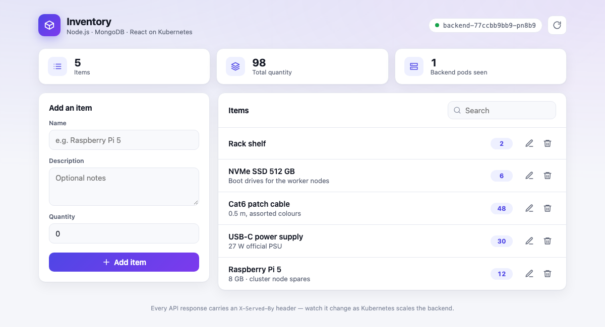
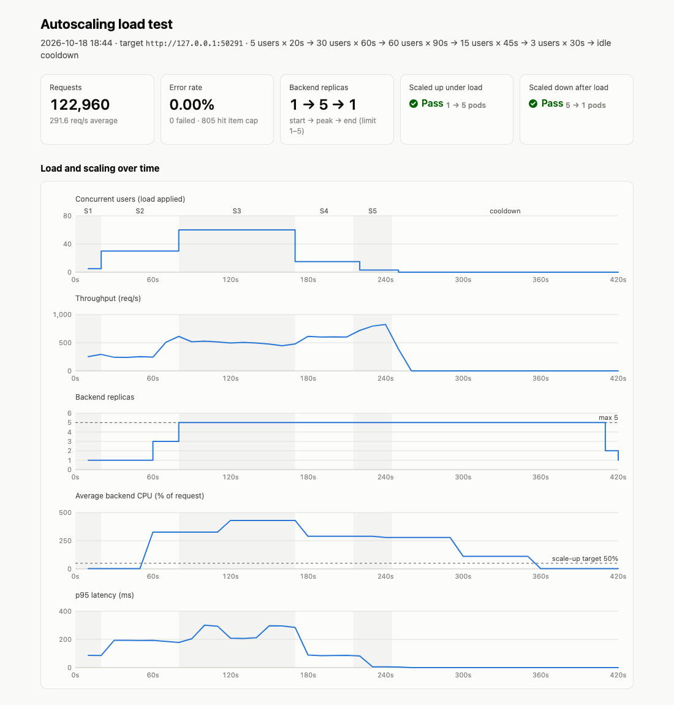
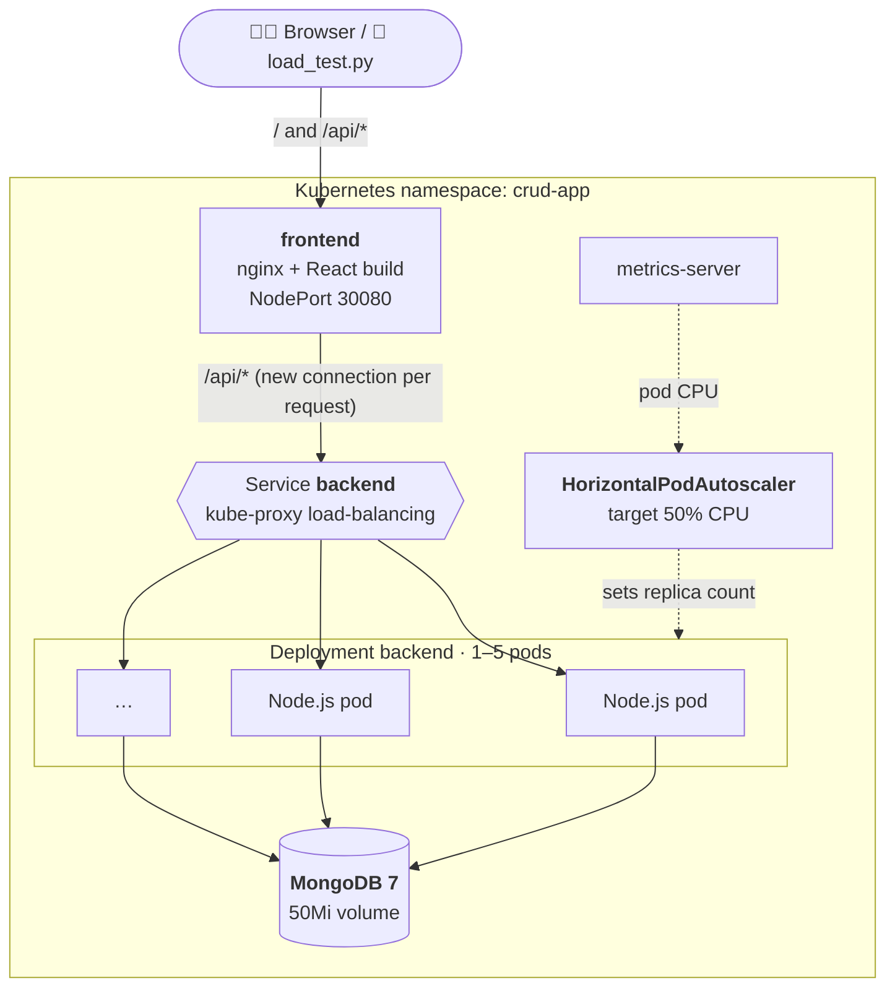

<div align="center">

# 📦 node-docker-kube

**A small CRUD app that scales itself.**<br>
Node.js + MongoDB + React, containerised with Docker, autoscaled by Kubernetes, and proven by a Python load test.


<picture>
  <source media="(prefers-color-scheme: dark)" srcset="docs/images/app-dark.png">
  
</picture>

</div>

---

## ✨ Highlights

- **Full CRUD** with an Express + Mongoose API and a React UI.
- **Horizontal autoscaling.** A Kubernetes HPA scales the Node.js backend from **1 to 5 pods** on CPU, and back down when load drops.
- **Visible load balancing.** Every response carries an `X-Served-By: <pod>` header. The UI shows which pod answered you, and the load test counts how many pods are serving.
- **Staged Python load test.** It ramps up, peaks, ramps down, watches the replica count with `kubectl`, prints a pass/fail verdict and writes an **interactive HTML report**.
- **Tiny footprint.** App images are 28 MB and 6 MB, backend pods run under 50Mi, and the database uses about 2 MB on disk with a capped item count.

## 📚 Field guide

[`docs/guide.html`](docs/guide.html) walks through every Dockerfile and Kubernetes config line by line. It covers multi-stage builds, layer caching, requests and limits, probes, graceful scale-down and the HPA formula, and works through the test run's scaling decisions step by step. It also includes an interactive HPA calculator.

**[Read it rendered →](https://htmlpreview.github.io/?https://github.com/jyothishankit/node-docker-kube-test/blob/main/docs/guide.html)** (GitHub shows `.html` files as source.)

## 📊 Test results

The latest run on minikube used the default load profile.

| | Result |
|---|---|
| Requests | **122,960**, of which **0 failed** (0.00%) |
| Throughput | up to ~820 req/s, ~290 req/s on average |
| Scale-up | **1 → 3 → 5 pods**, within 20s of CPU crossing the 50% target |
| Scale-down | **5 → 2 → 1 pods**, ~60s after CPU dropped (HPA stabilisation window) |
| Peak memory | backend 35Mi/pod · nginx 11Mi · MongoDB 103Mi |
| Verdict | ✅ scaled up under load · ✅ scaled down when load dropped |

<picture>
  <source media="(prefers-color-scheme: dark)" srcset="docs/images/report-dark.png">
  
</picture>

📄 Full interactive report: [`loadtest/results/report-20261018-184437.html`](loadtest/results/report-20261018-184437.html). Download it and open it in a browser to get hover tooltips and the full interval table.<br>
🧾 Console output of the same run: [`loadtest/results/run-20261018-184437.log`](loadtest/results/run-20261018-184437.log)

## 🏗️ Architecture



## 🚀 Quick start

**Prerequisites:** Docker Desktop, [minikube](https://minikube.sigs.k8s.io/), `kubectl`, Python 3.10+.

```bash
# 1. Start minikube, enable metrics-server, build images, deploy everything
./scripts/deploy.sh

# 2. Get a URL for the app (keep this running; on macOS it holds the tunnel open)
minikube service frontend -n crud-app --url
#  → http://127.0.0.1:58660

# 3. In another terminal, watch the autoscaler
kubectl -n crud-app get hpa backend -w
```

Open the URL to use the app. The badge in the top-right corner shows which backend pod answered.

## 🔥 Run the load test

```bash
cd loadtest
python3 -m venv .venv && source .venv/bin/activate
pip install -r requirements.txt

python load_test.py --url http://127.0.0.1:58660 --open
```

By default the test runs these stages, then sends no traffic and keeps watching until the backend is back at `minReplicas` (at most 300s):

| Stage | 1 | 2 | 3 | 4 | 5 | cooldown |
|---|---|---|---|---|---|---|
| Duration | 20s | 60s | 90s | 45s | 30s | ≤300s |
| Concurrent users | 5 | 30 | **60** | 15 | 3 | 0 |

Each virtual user loops with no think time over a CRUD mix: 50% list, 15% create, 10% get, 10% update and 15% delete. When the test ends, each user deletes the items it created. While the test runs, it prints a line every interval:

```
  time phase      users   req/s   err capped  p50 ms  p95 ms pods hit  replicas desired       cpu
   80s stage 3       60   611.6     0      0      10     178        4 5/5            5  326%/50%
```

At the end it prints the replica timeline and a ✅/❌ verdict. The exit code is `0` only if the backend scaled up **and** back down. It also writes a self-contained HTML report to `loadtest/results/`, and `--open` opens it in your browser.

```bash
python load_test.py --stages 20:5,60:60,60:10 --cooldown 240   # custom profile
python load_test.py --interval 10                              # quieter output
python load_test.py --no-kubectl                               # no cluster access; uses "pods hit" only
python load_test.py --report my-run.html                       # choose the report path
```

## ⚖️ How the autoscaling works

[`k8s/30-backend-hpa.yaml`](k8s/30-backend-hpa.yaml) targets the `backend` Deployment:

| Setting | Value |
|---|---|
| Metric | average CPU, target **50%** of each pod's `100m` request (from `metrics-server`) |
| Range | **1–5** replicas |
| Scale up | immediately; doubles the pods or adds 2 every 15s, whichever is more |
| Scale down | after a **60s** stabilisation window (Kubernetes default: 300s), then up to 50% of pods every 15s |

These details keep scaling smooth:

- The backend Deployment has **no `replicas` field**, so the HPA owns the replica count, and re-applying the manifests won't reset it.
- A **`preStop` sleep** lets kube-proxy stop routing to a pod before it exits, so scaling down doesn't drop requests.
- **nginx opens a new upstream connection per request**, so pods the HPA has just added start receiving traffic as soon as they're ready.
- A **`/ready` probe** only passes once MongoDB is connected.

## 🪶 Resource footprint

Every component has small, explicit limits. All numbers below were measured on minikube.

| Component | Memory limit | Measured peak | Disk |
|---|---|---|---|
| backend (per pod, 1–5) | 50Mi | 35Mi | 28 MB image · 10Mi scratch limit |
| frontend (nginx, 1 pod) | 32Mi | 11Mi | 6 MB image · 10Mi scratch limit |
| MongoDB (1 pod) | 128Mi | 103Mi | 50Mi volume, ~2 MB used · 284 MB image (official `mongo:7`) |

<details>
<summary><b>How it's kept small</b></summary>

- **Database cap.** The API refuses new items with HTTP `507` once `MAX_ITEMS` (500) exist, and descriptions are capped at 500 characters. The cap is soft: concurrent creates across pods can pass the check together, so under heavy load the count can overshoot by ~100–150 items.
- **MongoDB tuning.** It uses a 16 MB WiredTiger cache, 2 MB journal files that aren't preallocated (the default is 100 MB each), and no `diagnostic.data` (up to 200 MB by default). Its allocator thread cache is limited to 4 MB, freed memory is released immediately, and connections are capped at 100. Without these settings it used **~300 MB of disk and ~170Mi of memory**.
- **MongoDB's memory floor is ~128Mi.** It's OOM-killed during startup below ~80Mi, idles at ~70Mi, and was OOM-killed at 96Mi under peak load with 5 backend pods connected.
- **Backend.** It runs on plain Alpine with its `nodejs` package: a 28 MB image, vs. 259 MB on `node:22-alpine`. It has a 24 MB V8 heap and a 3-connection pool, so 5 pods open at most 15 DB connections.
- **Frontend.** It uses `nginx:alpine-slim` with 2 worker processes. The default, `auto`, starts one per host CPU.
- **Images** are built directly inside minikube (`minikube image build`), so the host's Docker doesn't keep a second copy.

</details>

## 🔌 API

| Method | Path | Body | Response |
|---|---|---|---|
| `GET` | `/api/items?limit=50` | – | `200` list, newest first (max 200) |
| `GET` | `/api/items/:id` | – | `200` item · `404` |
| `POST` | `/api/items` | `{name, description?, quantity?}` | `201` item · `400` · `507` item cap reached |
| `PUT` | `/api/items/:id` | any of `{name, description, quantity}` | `200` item · `400` · `404` |
| `DELETE` | `/api/items/:id` | – | `204` · `404` |
| `GET` | `/health` · `/ready` | – | liveness · readiness (MongoDB connected) |

## 🗂️ Project structure

```
.
├── backend/                 Express + Mongoose API
│   ├── server.js
│   └── Dockerfile           Alpine + nodejs, 28 MB
├── frontend/                React (Vite) UI served by nginx
│   ├── src/                 App.jsx, Icon.jsx, api.js, styles.css
│   ├── nginx.conf           static files + /api proxy
│   └── Dockerfile           nginx:alpine-slim, 6 MB
├── k8s/                     namespace, mongo, backend, HPA, frontend
├── loadtest/
│   ├── load_test.py         staged load test + kubectl watcher
│   ├── report_template.html HTML report (charts, tiles, tables)
│   └── results/             committed results of the latest run
├── scripts/
│   ├── deploy.sh            minikube → build → apply → wait
│   └── teardown.sh
├── docs/
│   ├── guide.html           line-by-line guide to the Docker and Kubernetes configs
│   └── images/              screenshots used in this README
└── docker-compose.yml       plain-Docker dev setup (no autoscaling)
```

## 🐳 Local development without Kubernetes

```bash
docker compose up --build        # → http://localhost:8080
```

You can also run the pieces directly: start MongoDB on `localhost:27017`, then run `npm install && npm start` in `backend/` and `npm install && npm run dev` in `frontend/`. Vite serves on `:3000` and proxies `/api` to `:5000`.

## 🧹 Cleanup

```bash
./scripts/teardown.sh     # delete the crud-app namespace (pods, MongoDB volume and data)
minikube stop
```

To bulk-delete every item but keep the app running, use a throwaway `mongosh` pod. Running `mongosh` inside the mongo pod would count against MongoDB's 128Mi limit.

```bash
kubectl -n crud-app run mongo-cleanup --rm -i --restart=Never --image=mongo:7 --command -- \
  mongosh --quiet mongodb://mongo:27017/crud --eval 'printjson(db.items.deleteMany({}))'
```

## 🩺 Troubleshooting

| Symptom | Fix |
|---|---|
| HPA shows `cpu: <unknown>/50%` | `metrics-server` is still warming up and needs 1–2 minutes on a fresh cluster. Check with `kubectl top pods -n crud-app`. |
| The app URL stops responding | The `minikube service … --url` tunnel was closed, or it dropped when the frontend pod was replaced. Run it again; the port changes each time. |
| Scale-down seems slow | That's expected. Metrics lag ~60s, and then the 60s stabilisation window applies. |
| MongoDB `OOMKilled` | Keep its limit at 128Mi or higher; see the footprint notes above. |
